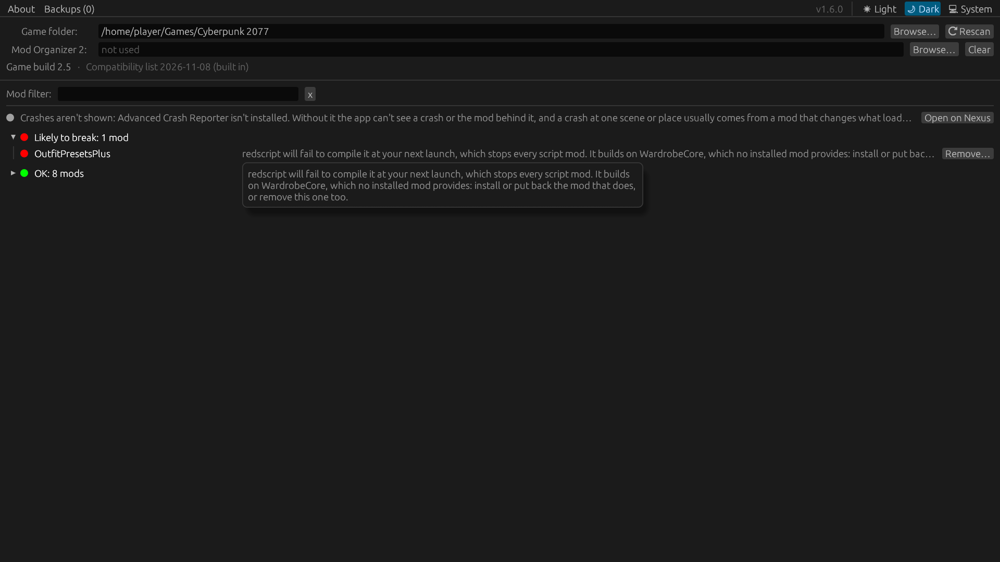
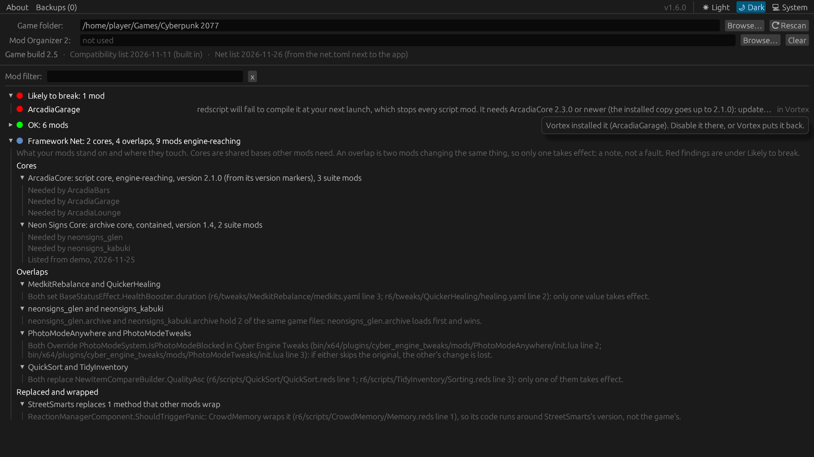
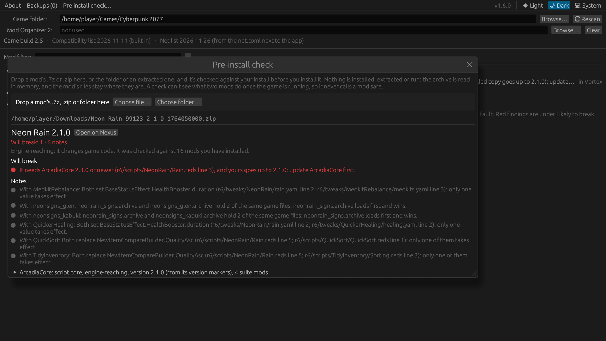
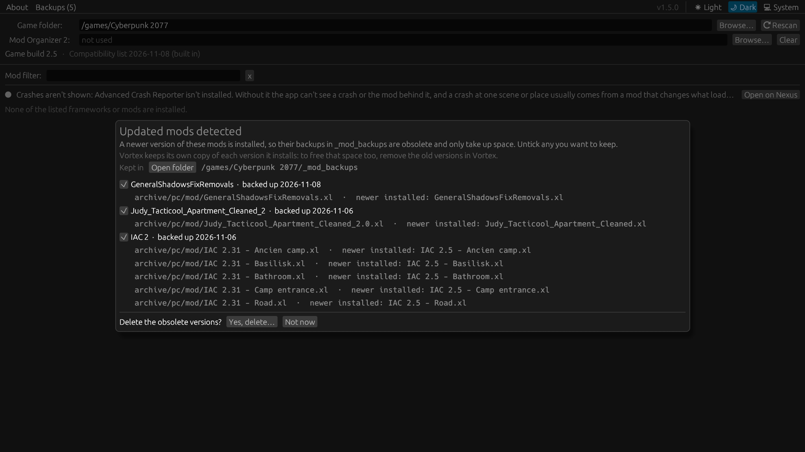

# Cyberpunk-Mod-Compatibility-Checker

Check your Cyberpunk 2077 mods before you launch. It tells you which mods are likely to break on your game version, with a link to each fix, and after a crash it shows what went wrong and which mod was blamed. You can also check a mod you haven't installed yet, before you install it. It runs on Windows, Linux and macOS (where it only reports).

Published on Nexus Mods by [FauxNoodles](https://next.nexusmods.com/profile/FauxNoodles), who maintains this repository.

## Quick start

1. **Open the app.** It finds your game and remembers the folder from then on. If it can't, press **Browse…** and pick the folder that holds `bin`, `archive` and `r6`.
2. **Fix what's red.** Use **Open on Nexus** to update a mod, or **Remove…** to set it aside until its update arrives.
3. **Run the game.**
4. **After a crash, open the app again.** "Your last launch" shows what went wrong.

To have it check before every launch, see [Checking before every launch](#checking-before-every-launch).

## How it works

- It finds your game by itself (Steam, GOG or Epic on Windows; Steam or Heroic on Linux) and reads its version, your frameworks (RED4ext, Cyber Engine Tweaks, redscript, ArchiveXL, TweakXL, Codeware and others), your mods, Mod Organizer 2's included, and the logs from your last launch.
- It compares them with a curated list of the lowest framework versions that work on each game build, the mods that depend on them, and known problems. The list is updated after game patches (see [The compatibility list](#the-compatibility-list)).
- Each framework, and each mod that depends on one, gets a verdict: red (likely to break), gray (not confirmed for your build yet) or green (OK). Each comes with the reason and **Open on Nexus** for the update. Other mods appear only when something is wrong with them (see [Which mods it shows](#which-mods-it-shows)).
- If you ask, it backs up and removes a broken mod until its update arrives, then restores it. It lists every file before changing anything.
- Each scan also checks those backups. When a newer version of a backed-up mod is installed, it shows **Updated mods detected** and asks whether to delete the obsolete versions.
- With one line in Steam's launch options, it checks every time you press Play. The game starts at once when nothing is red. Otherwise the app shows what's wrong and waits for you.
- The **Framework Net** maps what your mods stand on and where they touch each other: the shared cores your mods need, and the places two mods change the same thing (see [The Framework Net](#the-framework-net)).
- The **Pre-install check** reads a mod you haven't installed yet and checks it against the mods you have (see [Pre-install check](#pre-install-check)).

## Download

Grab the latest build from the [Releases](../../releases) page. See the [Code signing policy](#code-signing-policy) for Windows signing.

- **Windows:** `CyberpunkModCompatibilityChecker-windows.exe`
- **Linux:** `CyberpunkModCompatibilityChecker-linux` (run `chmod +x CyberpunkModCompatibilityChecker-linux` once)
- **macOS (Apple silicon):** `CyberpunkModCompatibilityChecker-macos.zip` holds `Cyberpunk Mod Compatibility Checker.app` (see [macOS](#macos))
- **Windows, as an archive:** `CyberpunkModCompatibilityChecker-v<version>-windows.7z` holds the same exe with this README, the license and `THIRD-PARTY-NOTICES.txt`. This is the file uploaded to Nexus Mods.

Each is a single program with nothing to install and nothing unpacked to a temp folder. On Linux it needs a desktop session (X11 or Wayland) with OpenGL.

## What it does and doesn't do

- It **never connects to the internet**. "Open on Nexus" hands the mod's page to your own web browser, and only when you click it. Links are built from the mod's Nexus number, so they can only ever point at nexusmods.com.
- It **changes files only when you ask**, and shows every folder and file first (see [Backing up and removing a mod](#backing-up-and-removing-a-mod)). Otherwise it only reads: your mods (for archives, only their file index), the logs from your last launch (RED4ext's, redscript's, your mods' own, and Advanced Crash Reporter's reports, log and settings if you use it) and, on Windows, the version of the Visual C++ runtime.
- It **never touches the game's own files or the frameworks**, including a framework's scripts. It offers only whole mod folders and files in the mod folders: `archive/pc/mod`, `r6/scripts`, `r6/tweaks`, `red4ext/plugins`, Cyber Engine Tweaks' `mods`, `.asi` files in `bin/x64/plugins`, and REDmod's `mods`. Mods installed with Mod Organizer 2 are left to MO2: untick them there.
- It **never moves or deletes anything outside your game folder**. If a folder on the way to a mod, such as `r6/scripts`, is a link or junction to somewhere else, it leaves that mod to you.
- It **starts the game only when you set it up to** (see [Checking before every launch](#checking-before-every-launch)), and then only the command Steam gives it.
- Apart from removals you ask for, the only file it writes is its own settings (the folders you chose and the theme). See [Removing it](#removing-it).

## Using the app

1. Start it. It finds your game on its own (Steam, GOG or Epic on Windows; Steam or Heroic on Linux). If it can't, press **Browse…** and pick the folder that holds `bin`, `archive` and `r6`. You can also drop the game folder onto the exe.
2. If you use **Mod Organizer 2**, it finds your MO2 instance and scans your enabled mods too. Pick a portable instance with the second **Browse…** (the folder that holds `ModOrganizer.ini`). **Clear** stops using MO2. Vortex and manual installs need nothing extra, since their mods sit in the game folder.
3. Read the groups:
   - **Your last launch:** what the game's logs recorded the last time it ran: a crash and the mod the crash reporter blamed (plus the other mods on the crash's call path), and the errors your mods logged. When the crash reporter blames a framework that matches the list, the app says a mod using it is the likelier cause. When the crash was handling a named character, such as misty.ent, it lists the mods named after that character, such as a redesign, to try without first. When the game ran out of memory, it says so instead of blaming a mod, and it warns when memory was nearly full at a crash or just before the game closed (from the crash reporter's last snapshot), since that can crash the game or cut its sound. A "freeze" report written while a message box waited for you, such as redscript's error box, is left out. **Open report** opens the crash report in your text editor. It updates after each launch.
   - **Red, likely to break:** a framework older than the lowest version known to work on your game build, a framework that needs an update for every game patch, a missing framework that one of your mods needs, a mod that needs a red framework, or a known problem reported for your build. Also red: a RED4ext plugin built for another game version (RED4ext won't load it), a missing loader file, a Visual C++ runtime too old for a framework, a missing Wine DLL override on Linux, a script mod redscript couldn't compile at your last launch (that stops every script mod; the reason says whether a mod it builds on is missing, part of it is installed twice, or it needs an update), a script mod that imports a module no installed mod provides, such as an add-on left behind after its main mod was removed (redscript would fail to compile it at your next launch, so this is caught before you start the game), a mod whose world edits ArchiveXL skipped because the map has changed since it was made (with a note when a second copy sits in a plugin folder), a script RED4ext closed the game over because no loaded plugin provides the native code it declares, a file one of your mods' own logs calls older, conflicting or still installed, a mod Advanced Crash Reporter calls the strong or likely culprit of your last crash or freeze because its own code was running (see [Advanced Crash Reporter](#advanced-crash-reporter)), and known clashes between files, such as an old version left next to its replacement.
   - **Gray, not confirmed:** the list doesn't cover your game build yet, or the list for your build is still a draft.
   - **Green, OK:** matches the list for your build.
   - **Unlisted native plugins:** RED4ext plugins and `.asi` files the list doesn't know. These hook the game directly and often break after a patch.
   - **Crashes aren't shown** (gray, at the top): [Advanced Crash Reporter](https://www.nexusmods.com/cyberpunk2077/mods/34403) isn't installed. The app reads crashes only from its reports, so without it a crash leaves no trace here. Removing the red mods fixes what a game patch broke; a crash at one scene or place usually comes from a mod that changes what loads there (an appearance, body or animation mod), which only a crash report can point to.

   Hover a circle or a reason to read it in full. A banner at the top warns when your game is newer than the list, which usually means CDPR has just released a patch.
4. Use **Open on Nexus** or **Copy link** to get each update, or **Remove…** to take a broken mod out until then.

## Which mods it shows

It doesn't list every mod you have, only the ones most likely to break after a patch and the ones your last launch shows broken, so seeing 16 of your 66 mods is normal. Mods installed with Mod Organizer 2 count the same as the rest.

**Always listed when installed:**

- **Frameworks** (RED4ext, Cyber Engine Tweaks, redscript, ArchiveXL, TweakXL, Codeware, RedFileSystem, Mod Settings, Input Loader, Native Settings UI, Audioware) and **the mods on the list that lean on them**, such as Appearance Menu Mod, Equipment-EX and Virtual Atelier. Each gets red, gray or green. A missing framework is listed only when one of your mods needs it.
- **RED4ext plugins and `.asi` files the list doesn't know**, in the gray **Unlisted native plugins** group. Gray here means not judged: they hook the game directly, so check them after a patch. A RED4ext plugin built for another game version turns red.

**Shown only when something is wrong:**

- **Archive mods** (`archive/pc/mod`): when ArchiveXL skipped the mod's world edits at your last launch, or when the mod replaces one of the game's sound index files with a copy from an older patch, which mutes menu, footstep and ambient sounds. The app reads each archive's file index for this; it never unpacks an archive.
- **Script mods** (`r6/scripts`): when redscript couldn't compile the mod, when it imports a module no installed mod provides (checked before every launch), or when RED4ext closed the game over one of its scripts.
- **TweakXL, CET and REDmod mods** (`r6/tweaks`, CET's `mods`, `mods`): no check of their own yet. Errors that TweakXL, ArchiveXL and other RED4ext plugins log appear under **Your last launch**. CET's logs aren't read.
- **Any of these** also turn red when a mod's log at your last launch calls the file older, conflicting or still installed, or when the list knows a clash between its files. With Advanced Crash Reporter installed, **Your last launch** can also name any mod as the crash's culprit or on its call path, and a mod whose own code was running at the crash turns red.

**Gray** on a listed mod means the list doesn't cover your game build, is still a draft for it, couldn't read the mod's version, or the mod needs a framework that's gray. The green **OK** group starts collapsed: click its title to open it.

## Checking before every launch

On Steam, the app can run every time you press Play. In Steam, right-click Cyberpunk 2077, open **Properties**, and under **Launch Options** enter the path to the app followed by `--launch %command%`:

```
"C:\Tools\CyberpunkModCompatibilityChecker.exe" --launch %command%
```

From then on it checks your mods first. If nothing is red, the game starts straight away. If something is, the game waits and the app shows it, with **Launch anyway** and **Don't launch**. On Linux, use the path to `CyberpunkModCompatibilityChecker-linux` instead. To stop, clear the launch options. Mod Organizer 2 users start the game from MO2, since a Steam launch skips MO2's mods.



## The Framework Net

The **Framework Net** group maps what your mods stand on and where they touch each other. It's read from your mods' own files, not from a list of known pairs, so it covers mods nobody has written a rule for.

- **Cores** are the shared bases other mods need: a framework, or one author's base mod that the rest of their mods build on (a *suite core*). Each row says whether the core changes game code, its version where the app can tell, and which of your mods need it. A script core's version comes from its version markers, an archive core's from a fingerprint of its archive, and a mod installed with Mod Organizer 2 can also give its version from MO2.
- **Overlaps** are two mods changing the same thing, so only one of them takes effect: the same method replaced twice, the same Cyber Engine Tweaks override, the same tweak field set twice, or the same game file in two archives (there the one earlier by name wins). Each line names the file and line in both mods. An overlap is a note, never a verdict: plenty of them are deliberate.
- **Replaced and wrapped** lists the methods one mod replaces outright while another wraps them. Both still run, so it's shown as a detail, not a problem. Two mods wrapping the same method chain safely and aren't shown at all.

A row is red only for a certain break, and those stay under **Likely to break**: something a mod needs is missing or too old, a core is installed twice, or the list knows the clash.

The Net's data (the archive cores and their versions) lives in [`net.toml`](net.toml), separate from the compatibility list so that older versions of the app keep working with a newer `compat.toml` (see [docs/adr/0001-net-list-file.md](docs/adr/0001-net-list-file.md)). A newer `net.toml` next to the exe is used instead, the same way.



## Pre-install check

**Pre-install check…** in the menu bar checks a mod you haven't installed yet. Drop its `.7z` or `.zip` on the window, or press **Choose file…** (or **Choose folder…** for an already-extracted mod). You can also drop a mod's archive onto the app itself.

- Nothing is installed, extracted, written or run. The archive is read in memory, and the mod's files stay where they are.
- The result opens with **Will break: N** or **No certain breaks found**, plus the number of notes. It never calls a mod safe: what two mods do once the game is running can't be seen before launch.
- Each finding names the file and line inside the mod: a module it needs that nothing provides, a core older than it asks for, a framework you don't have, and the mods it would overlap with.
- If the mod has a **FOMOD installer**, its options are shown ticked the way the installer would have them, and only the ticked files are checked. Change them and the check runs again.
- Each mod's last result is kept in the app's own settings. If that mod later turns red, its row says what the check found and when.



## macOS

The Mac app (Apple silicon) **only reports**. It never moves, deletes or restores anything, and it has no launch mode. The Mac game loads redscript and archives patched into it, but not RED4ext, Cyber Engine Tweaks, ArchiveXL, TweakXL or Codeware, so the app checks script imports, mods that need a framework macOS can't run, and mods installed twice, and it tells you what to change by hand.

It isn't notarized by Apple, so macOS asks before it runs the first time: open **System Settings → Privacy & Security**, scroll to the message about the app, and press **Open Anyway**. (Or right-click the app in Finder and choose **Open**.) The app is ad-hoc signed by the build, which proves it hasn't changed since GitHub Actions built it, not who made it.

## Backing up and removing a mod

Red mods have a **Remove…** button, and **Remove all…** takes every removable red mod at once. Close the game first. The window lists every folder and file the mod has in your mod folders, including ones with the same name in other mod folders (marked "same name"). For a single file left from an older version, only the files beside it with its name are listed, never the current version of the mod. A file inside another mod's folder can't be removed by the app, so its row says which file to move out by hand. It also lists the mods whose scripts build on it, with their files (marked "builds on …"): without it, redscript can't compile them, and that stops every script mod. If one of them is in Mod Organizer 2, the window says to untick it there. Untick any you want to keep, then choose:

- **Back up and remove** moves them into `_mod_backups/<date> <mod>/` in your game folder, keeping their folder paths, with a `backup.toml` that records what was moved and why. Nothing is deleted. The move stays on the same drive, and if any part fails, everything already moved is put back.
- **Delete permanently…** asks a second time, then deletes them for good.

The **Backups** window (top left) lists your backups, with the full path of the folder they're kept in and **Open folder** to see it in your file manager. The Remove window shows the same path before anything moves. **Restore** puts a mod back once it's updated, and never overwrites files that have been installed again since. If you've installed the update already, **Delete…** removes the old backup for good, after showing what it holds. Windows may refuse a change, for example while the game is running or when the game is under Program Files. The app then says so, and nothing is changed.

### Updated mods detected

Every scan compares your backups with the mods installed now. A backup counts as obsolete when the same mod folder holds a newer file or folder with the same name, or the same name with another version in it (`IAC 2.31 - Road.xl` replaced by `IAC 2.5 - Road.xl`). Newer means modified later and not an identical copy. The dates decide, not the numbers, since authors number versions differently. Mods in Mod Organizer 2 count too.

The app then opens **Updated mods detected**, which lists each obsolete backup with the newer file that replaced it, all ticked. **Delete the obsolete versions?** asks a second time before it deletes the ticked backups for good. Only the backups are deleted, never your installed mods. **Not now** keeps them, and a banner with **Review…** stays until you decide. The window opens again only when another backup becomes obsolete. An obsolete backup can't be restored, since that would put the old version back beside the new one. If Vortex installed your mods, it keeps its own copy of every version, so remove old versions in Vortex too.



## The compatibility list

The list is [`compat.toml`](compat.toml). It holds the game builds it covers, the frameworks with the lowest working version per build, and the mods that lean on them, with any known problems and where each report came from. It's built into every release. [`net.toml`](net.toml) is the second list, for the [Framework Net](#the-framework-net): the shared cores, their versions by fingerprint, and the mods in each one's suite.

Between releases, the maintainer may publish a newer `compat.toml` or `net.toml` on the Nexus page. Put it next to the exe. The app uses it if its `updated` date is newer than the built-in list's, and tells you if it couldn't read it. The header line names the date of each list and where it came from.

The list is maintained with a Claude agent ([`.claude/agents/compat-bridge.md`](.claude/agents/compat-bridge.md)). After a game patch, a framework or mod update, or a bug report a player posted on Nexus, it reads the release notes or the report and proposes an update for the maintainer to review. A single report changes nothing until it's confirmed, and no reporter's name or personal details go into the repo. The agent runs on the maintainer's side and is not part of the app. A build stays a draft until the maintainer has run the game on it.

## Command line

```
CyberpunkModCompatibilityChecker --report [<game folder>] [<MO2 instance folder>]
CyberpunkModCompatibilityChecker --precheck <mod .7z, .zip or folder> [<game folder>]
CyberpunkModCompatibilityChecker --launch <game command>
```

`--report` prints the same verdicts as text, without opening a window. It lists what **Remove…** would take, but never changes a file. `--precheck` prints the [Pre-install check](#pre-install-check)'s result for one mod. `--launch` checks first and then runs the game command, as described in [Checking before every launch](#checking-before-every-launch).

## Removing it

Delete the exe (on macOS, the app). To remove its settings too, delete `%APPDATA%\Cyberpunk Mod Compatibility Checker` on Windows, `~/.local/share/cyberpunkmodcompatibilitychecker` on Linux, or `~/Library/Application Support/Cyberpunk Mod Compatibility Checker` on macOS. If you backed up mods, `_mod_backups` in your game folder holds them: restore or delete them first, or delete the folder yourself.

## Verifying downloads

Every release binary is built by GitHub Actions straight from this repository, with a `.sha256` checksum and a signed build-provenance attestation alongside it:

```
sha256sum -c CyberpunkModCompatibilityChecker-linux.sha256          # Linux
Get-FileHash CyberpunkModCompatibilityChecker-windows.exe            # Windows PowerShell; compare with the .sha256 file
gh attestation verify CyberpunkModCompatibilityChecker-windows.exe -R Adaptive-Protocol/Cyberpunk-Mod-Compatibility-Checker
```

## Code signing policy

Signing is being set up, so releases made before it's ready are unsigned and Windows may warn about them. From then on, the Windows app (`CyberpunkModCompatibilityChecker-windows.exe`, shipped in the Nexus .7z as `CyberpunkModCompatibilityChecker.exe`) is signed with [Microsoft Azure Artifact Signing](https://learn.microsoft.com/azure/artifact-signing/). The publisher Windows shows is the developer's registered business, whose identity Microsoft validated. To check the file, open its Properties and then the Digital Signatures tab.

- Signed files are built only by this repository's GitHub Actions workflow, from the tagged source. Nothing is signed on a personal computer.
- Each release runs in a protected `release` environment and is approved by the maintainer, [Adaptive-Protocol](https://github.com/Adaptive-Protocol), before signing.
- The workflow refuses to release an unsigned Windows file once signing is switched on, and checks the signature before publishing.

**Privacy policy:** This program will not transfer any information to other networked systems unless specifically requested by the user or the person installing or operating it.

## Building

The app is written in Rust with [egui](https://github.com/emilk/egui). With [Rust](https://rustup.rs) installed:

```
cargo build --release          # binary in target/release/
cargo test                     # verdict, list, detection and backup tests
```

Pushing a `v*` tag that matches the version in `Cargo.toml` builds the app for Windows, Linux and macOS on GitHub Actions and attaches it to a GitHub release, together with checksums, `THIRD-PARTY-NOTICES.txt` and the Nexus .7z (see `.github/workflows/build.yml`).

## Advanced Crash Reporter

[Advanced Crash Reporter](https://www.nexusmods.com/cyberpunk2077/mods/34403) writes a report each time the game crashes or freezes. With it installed, the app reads the newest report from your last launch, with no setup:

- **The crash or freeze** and the reporter's verdict appear under **Your last launch**, with **Open report**.
- **The mod behind it turns red** when the reporter calls it the strong or likely culprit because its own code was running, with **Remove…** to back it up. Frameworks such as ArchiveXL stay as they are: crashes often only pass through them, so the app says a mod that uses one is the likelier cause. A mod you've updated or replaced since the crash isn't flagged, and neither is any mod when the game ran out of memory.
- **Moved reports are found:** the app follows the `output_dir` set in the reporter's `config.ini`.
- **No RED4ext needed:** the reporter's own log tells the app when you last launched.

Without the reporter, everything else works the same, and a gray line says crashes can't be seen.

## Credits and origins

Where the app's design and code come from:

- **Design:** the look follows [red4-conflicts](https://github.com/rfuzzo/Cyberpunk-utility) by [rfuzzo](https://github.com/rfuzzo), a conflict checker for Cyberpunk 2077 archive mods: the dark theme with its Light / Dark / System switch, and rows with coloured status circles. No code was copied. The verdicts, the compatibility list and the layout are this app's own.
- **File actions:** backing a mod up instead of deleting it follows the reversible "disable" that mod managers such as Vortex and Mod Organizer 2 offer. The confirmation that lists every file, with permanent delete as a separate step, comes from the maintainer's [Nexus Mod Duplication Cleanup](https://github.com/Adaptive-Protocol/Nexus-Mod-Duplication-Cleanup).
- **Crash reports:** [Advanced Crash Reporter](https://www.nexusmods.com/cyberpunk2077/mods/34403) by Akiway writes the crash and freeze reports the app reads when it's installed. The app only reads them (the verdict, the mods involved, memory) and links to the mod; none of its code is used.
- **Archive file index:** the layout of an `.archive`'s file index and its path hashes (FNV-1a 64) are as the modding community documented them in [WolvenKit](https://github.com/WolvenKit/WolvenKit). No code was copied. Checking for sound index files from an older patch came from tracking down missing sounds on the maintainer's own 2.5 install.
- **Framework knowledge:** which frameworks matter and how they depend on each other comes from the [RED Modding wiki](https://wiki.redmodding.org/cyberpunk-2077-modding/for-mod-creators-theory/core-mods-explained) and each framework's own release notes. The frameworks belong to their authors; this app only checks for them.
- **Version markers:** reading a suite core's version from marker modules such as `DigitalVixenCore.Api4_9_12` follows the convention [DigitalVixen](https://next.nexusmods.com/profile/DigitalVixen) uses for their core and the mods that need it. The app only reads the names; nothing of theirs is included.
- **Which archive wins:** that the archive loaded first wins a shared game file, and the idea of showing it as a win/lose pair rather than a fault, comes from [red4-conflicts](https://github.com/rfuzzo/Cyberpunk-utility) by [rfuzzo](https://github.com/rfuzzo). No code was copied.
- **macOS:** what the Mac game can and can't load (archives patched in and redscript, no RED4ext, CET, ArchiveXL, TweakXL or Codeware) comes from the [RED Modding wiki's macOS page](https://wiki.redmodding.org/cyberpunk-2077-modding/for-mod-users/modding-on-macos) and from [cp2077-mac-archive-patcher](https://github.com/brunoformagio/cp2077-mac-archive-patcher) by [brunoformagio](https://github.com/brunoformagio), which is where the Mac game's own paths are documented. No code was copied, and this app never patches anything.
- **Mod archives and installers:** the [Pre-install check](#pre-install-check) reads `.7z` with [sevenz-rust2](https://github.com/hasenbanck/sevenz-rust2) and `.zip` with [zip](https://github.com/zip-rs/zip2), both pure Rust, so no C or C++ code goes into the app, and it parses FOMOD installers with [quick-xml](https://github.com/tafia/quick-xml). The FOMOD format itself is the modding community's, as Mod Organizer 2 and Vortex implement it.
- **Compatibility list:** curated by the maintainer. The list for 2.5 was seeded from the maintainer's own updated 2.5 install and confirmed by a launch test on it.
- **Libraries:** [egui/eframe](https://github.com/emilk/egui) draws the window, [rfd](https://github.com/PolyMeilex/rfd) opens the native file and folder picker, [serde](https://serde.rs) with [toml](https://github.com/toml-rs/toml) reads the lists and writes each backup's record, and sevenz-rust2, zip and quick-xml read a mod before it's installed. They and their dependencies all use permissive licenses (MIT, Apache-2.0, BSD, Zlib and similar). Each release includes `THIRD-PARTY-NOTICES.txt` with their full license texts.
- **AI:** the code, tests, list format, agent and documentation were written by an AI assistant (Claude, made by Anthropic) at the maintainer's direction. On Nexus Mods the app is tagged AI-Generated Content.

The **About** menu in the app shows the same credits.

## License

MIT, see [LICENSE](LICENSE).
